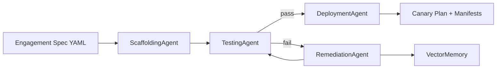

# Agentic FDS Orchestration Engine

> A multi-agent SDLC pipeline for **Forward Deployed Squads** — scaffold, validate, self-heal, and promote, from a single engagement spec.

[](https://github.com/chetanrajun-commits/agentic-fds-orchestrator/actions/workflows/ci.yml)
[](LICENSE)
[](https://www.python.org/)
[](https://github.com/astral-sh/ruff)

---

## Why this exists

Forward Deployed Squads sit between a client's compliance regime and a platform team's delivery cadence. Every new engagement re-invents the same scaffolding — namespaces, deployment manifests, policy annotations, cost tags, canary rollouts. The result is fragmented multi-tenant constraints, manual code forks, and slow first-deploy.

This repository is a **reference implementation** of the fix: a single orchestrator that turns an engagement spec into a validated, self-healed, canary-ready artifact set — deterministically, without any external service or API key.

---

## What it does

1. **Scaffolds** — reads an `EngagementSpec` and renders the base Kubernetes manifests.
2. **Validates** — runs the manifests against `fds-policy-pack-v1` (FinOps limits, Istio enrollment, data-classification encryption).
3. **Self-heals** — if a rule fails, a remediation agent patches the offending manifest and the pipeline re-validates.
4. **Promotes** — on success, emits a four-step Istio canary plan for the platform team to apply.

Every step is recorded into a namespace-isolated vector memory, mirroring the "Vector Isolation Architecture" pattern used in production.

---

## Demo

```bash
pip install -e .
agentic-fds run --spec examples/engagement-spec.yaml --workdir out
```

Output (from the CI run — [see it live](https://github.com/chetanrajun-commits/agentic-fds-orchestrator/actions)):

```
[ORCHESTRATOR] Engagement: client=acme-corp squad=atlas tier=prod
[SCAFFOLD]     Generated 3 manifest(s) for engagement acme-corp
[TEST]         4 policy violation(s) under fds-policy-pack-v1
[TEST]           - FDS-FINOPS-001  acme-corp-deployment.yaml: container 'acme-corp' missing resource limits
[TEST]           - FDS-FINOPS-002  acme-corp-deployment.yaml: container 'acme-corp' missing resource requests
[TEST]           - FDS-ISTIO-001  acme-corp-deployment.yaml: pod template missing Istio sidecar injection annotation
[TEST]           - FDS-SEC-001  acme-corp-deployment.yaml: finops.io/encryption: at-rest required for confidential data
[REMEDIATE]    Attempt 1/3
[REMEDIATE]    Applied 4 rule(s) across 1 file(s): FDS-FINOPS-001, FDS-FINOPS-002, FDS-ISTIO-001, FDS-SEC-001
[TEST]         All manifests passed fds-policy-pack-v1
[DEPLOY]       Emitted canary promotion plan for acme-corp (4 steps, Istio mesh)
[MEMORY]       1 fix pattern(s) recorded (namespace=fds-acme-prod)
[ORCHESTRATOR] ✅ Pipeline complete
```

Artifacts land in `out/` — the namespaced Deployment, Service, Namespace, and a `*-canary-plan.yaml` containing an Istio VirtualService + DestinationRule. The CI uploads the same directory as a downloadable artifact on every green run.

---

## Architecture



Full design doc, agent contracts, and the policy pack: [`docs/architecture.md`](docs/architecture.md).

---

## Repository layout

```
agentic-fds-orchestrator/
├── .github/workflows/ci.yml          # Lint · test on 3.10/3.11/3.12 · run demo
├── docs/architecture.md              # Design doc
├── examples/engagement-spec.yaml     # Sample input
├── iac/                              # Terraform: VPC + EKS with FinOps tags
├── src/agentic_fds/
│   ├── agents/                       # Scaffolding · Testing · Remediation · Deployment
│   ├── cli.py                        # `agentic-fds` entrypoint
│   ├── models.py                     # EngagementSpec · AgentResult · PolicyViolation
│   ├── orchestrator.py               # The MAS loop
│   └── vector_memory.py              # Namespace-isolated vector store
├── tests/                            # pytest suite, 15 tests
├── Dockerfile
├── Makefile
└── pyproject.toml
```

---

## Quickstart

**Prerequisites:** Python 3.10+.

```bash
git clone https://github.com/chetanrajun-commits/agentic-fds-orchestrator.git
cd agentic-fds-orchestrator
make dev      # install with dev deps
make test     # 15 tests
make run      # run the pipeline end-to-end
```

Or with Docker:

```bash
docker compose up --build
```

No API keys are required. The remediation path is deterministic on purpose, so the pipeline runs identically on any laptop and in CI.

---

## Design principles

- **Uniform agent contract.** Every agent returns `AgentResult`. The orchestrator composes through that interface alone.
- **Deterministic by default.** No LLM, no network, no secrets. Reproducible across machines and CI.
- **Structured violations, not logs.** `PolicyViolation(rule_id, file, message)` — remediators consume structured data.
- **Honest scope.** Reference implementation, not a product. See "Non-goals" in the design doc.
- **LLM-ready.** `RemediationAgent._apply` is one function. Swap it for an OpenAI-generated diff and the rest of the pipeline is unchanged.

---

## Policy pack — `fds-policy-pack-v1`

| Rule ID | Scope | Enforced |
|---------|-------|----------|
| `FDS-FINOPS-001` | Deployment containers | `resources.limits` present |
| `FDS-FINOPS-002` | Deployment containers | `resources.requests` present |
| `FDS-ISTIO-001` | Pod template | `sidecar.istio.io/inject: "true"` annotation |
| `FDS-SEC-001` | Pod template | `finops.io/encryption: at-rest` for confidential data |

---

## Extending

Add an agent in three steps:

1. `src/agentic_fds/agents/<name>.py` — implement `run(self, ...) -> AgentResult`.
2. Wire it into `src/agentic_fds/orchestrator.py`.
3. Add a test under `tests/`.

Natural next agents: **CostEstimator**, **SecurityScanner**, **ComplianceAuditor**.

---

## Roadmap

- [ ] LLM-backed remediation with Pinecone / pgvector memory of past fixes
- [ ] Policy-as-code via OPA / Rego
- [ ] GitHub App that opens a PR with generated manifests and the canary plan
- [ ] Backstage scaffolder action wrapping `agentic-fds run`
- [ ] OpenTelemetry → DORA dashboard exporter

---

## Infrastructure

`iac/` contains Terraform for a VPC and EKS cluster with per-engagement FinOps tags. It is illustrative — the pipeline does not require it to run.

```bash
cd iac
terraform init
terraform plan
```


---

## License

MIT — see [LICENSE](LICENSE).
