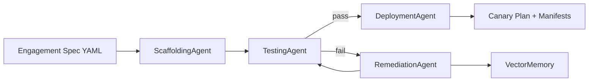

# Architecture — Agentic FDS Orchestration Engine

> Design document for the multi-agent SDLC pipeline that powers Forward Deployed Squads.

---

## 1. Problem

Forward Deployed Squads (FDS) operate at the intersection of a client's compliance regime and a platform team's delivery cadence. Every new engagement re-invents the same scaffolding: namespaces, deployment manifests, policy annotations, cost tags, canary rollouts. The result is predictable:

- **Fragmented multi-tenant constraints** — each engagement hand-rolls its own isolation.
- **Manual code forks** — the same manifest pattern copied, drifted, and re-copied.
- **Slow first-deploy** — days of toil before the squad ships a single commit to a client environment.

This repository is a reference implementation of the shape that fixes it: a single orchestrator that turns an **engagement spec** into a validated, self-healed, canary-ready deployment artifact set.

---

## 2. Pipeline



The loop terminates on the first of:

- TestingAgent returns zero policy violations → success.
- RemediationAgent fails to apply a fix → pipeline fails loudly.
- `max_attempts` (default 3) is exhausted → pipeline fails loudly.

Every step is deterministic. No LLM, no API key, no network call is required for the pipeline to produce identical output on any machine and in CI.

---

## 3. Agent contracts

Every agent implements one method:

```python
def run(self, ...) -> AgentResult
```

`AgentResult` is the uniform output contract:

```python
AgentResult(
    agent="testing",
    status="failure",
    message="4 policy violation(s) under fds-policy-pack-v1",
    artifacts={...},
    violations=[PolicyViolation(rule_id="FDS-FINOPS-001", file="...", message="..."), ...],
)
```

The orchestrator composes agents through this contract alone. This is what allows a new agent to be added without rewriting the pipeline.

| Agent | File | Input | Output | Responsibility |
|-------|------|-------|--------|----------------|
| ScaffoldingAgent | `agents/scaffolding.py` | `EngagementSpec` | Namespace, Deployment, Service YAML | Renders the base workload for an engagement |
| TestingAgent | `agents/testing.py` | Manifest directory + `EngagementSpec` | `AgentResult` with `PolicyViolation[]` | Validates against the FDS policy pack |
| RemediationAgent | `agents/remediation.py` | Failing `AgentResult` | Patched manifests + vector memory write | Applies the minimum patch to satisfy each violation |
| DeploymentAgent | `agents/deployment.py` | `EngagementSpec` | Istio VirtualService + DestinationRule canary plan | Emits the promotion plan for the platform team |

---

## 4. Policy pack — `fds-policy-pack-v1`

| Rule ID | Scope | Enforced |
|---------|-------|----------|
| `FDS-FINOPS-001` | Deployment containers | Must declare `resources.limits` |
| `FDS-FINOPS-002` | Deployment containers | Must declare `resources.requests` |
| `FDS-ISTIO-001` | Pod template | Must carry `sidecar.istio.io/inject: "true"` |
| `FDS-SEC-001` | Pod template | If `data_classification ∈ {confidential, restricted}`, must carry `finops.io/encryption: at-rest` |

Rules are intentionally small in number and rich in semantics. Each one maps to a real platform-team incident: unbounded pods (FinOps), missing mesh enrollment (ops), unencrypted confidential data (compliance).

Adding a rule is a two-line change to `TestingAgent._check_deployment` and a one-line branch in `RemediationAgent._apply`.

---

## 5. Vector memory — namespace isolation

The README describes a **Vector Isolation Architecture** with strict namespace isolation inside a vector store (Pinecone or pgvector).

`src/agentic_fds/vector_memory.py` implements that interface — `upsert`, `query`, namespace-scoped — backed by an in-process list. The embedding is a deterministic bag-of-words hashing embedder (`sha1` per token, `L2`-normalised, 64 dimensions), so:

- No external service is required to run the demo.
- No API key.
- Identical results across machines, CI runs, and OSes.

**Swap path to production:**

```python
# production
from pinecone import Pinecone

class PineconeMemory:
    def __init__(self, index_name: str, namespace: str) -> None: ...
    def upsert(self, id: str, text: str, metadata: dict) -> None: ...
    def query(self, text: str, top_k: int = 3) -> list[MemoryEntry]: ...
```

`RemediationAgent` does not change. That is the point of the abstraction.

---

## 6. Canary strategy

`DeploymentAgent` emits a four-step canary plan modelled on Istio traffic splitting:

| Step | Weight | Dwell | Promotion gate |
|------|--------|-------|----------------|
| 1 | 5% | 5m | `error_rate < 1%` and `p95_latency < 500ms` |
| 2 | 25% | 10m | `error_rate < 1%` and `p95_latency < 500ms` |
| 3 | 50% | 15m | `error_rate < 0.5%` and `p95_latency < 400ms` |
| 4 | 100% | steady | promoted |

The plan is a YAML artifact (VirtualService + DestinationRule). Applying it is the platform team's job via Argo Rollouts or Flagger. The reference implementation deliberately stops at "emit the plan" so the artifact is reviewable in a PR.

---

## 7. Extension points

The pipeline was built to be extended, not admired.

1. **LLM-backed remediation.** Replace `RemediationAgent._apply` with an OpenAI call that produces a unified diff, and apply it with `git apply`. The vector memory already exists to feed past fixes as context.
2. **Pinecone / pgvector.** Swap `VectorMemory` for a real client. Interface is stable.
3. **OPA / Rego policy.** The `fds-policy-pack-v1` module is a `TestingAgent` subclass away from delegating to Open Policy Agent.
4. **Backstage plugin.** `agentic-fds run` is a pure function over files. Wrap it as a Backstage scaffolder action and the CLI becomes a button in the IDP.
5. **GitOps opener.** After `DeploymentAgent` runs, open a PR via the GitHub API with the generated manifests and canary plan.
6. **DORA metrics exporter.** Emit `pipeline.completed`, `pipeline.failed`, `remediation.applied` counters to OpenTelemetry → Prometheus. The DORA dashboard is then free.

---

## 8. Non-goals (honest scope)

This is a reference implementation, not a product. Specifically:

- **No Kubernetes API access.** It generates YAML; it does not apply it.
- **No authentication.** No RBAC, no tenants, no secrets.
- **No LLM calls by default.** The remediation path is deterministic so the pipeline is reproducible in CI.
- **No persistent storage.** Vector memory is in-process. Restart the process, lose the fixes.
- **No real canary controller.** The plan is emitted; enforcement is Argo / Flagger's job.

The purpose of this repository is to make the **shape** of an agentic, self-healing SDLC pipeline concrete and reviewable — the same shape a Forward Deployed Squads platform would build on top of.

---

## 9. References

- [Istio traffic management](https://istio.io/latest/docs/concepts/traffic-management/)
- [Argo Rollouts canary strategy](https://argoproj.github.io/argo-rollouts/features/canary/)
- [Open Policy Agent](https://www.openpolicyagent.org/)
- [DORA metrics](https://dora.dev/)
- [Backstage software templates](https://backstage.io/docs/features/software-templates/)
